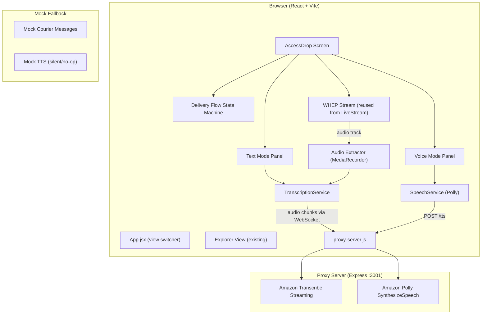

# Design Document: AccessDrop AI

## Overview

AccessDrop AI adds an accessibility-focused delivery interaction screen to the existing Ring AVA Explorer app. The feature provides two modes: Text Mode for deaf/hard-of-hearing customers (displaying courier speech as text with tap-based actions) and Voice Mode for blind/low-vision customers (spoken delivery guidance via Amazon Polly). The system extracts audio from the existing WHEP WebRTC stream, sends it to Amazon Transcribe for speech-to-text, and uses Amazon Polly exclusively for text-to-speech output. A mock data fallback ensures reliable demos when AWS services are unavailable.

The design prioritises hackathon MVP simplicity: minimal new dependencies, reuse of existing streaming infrastructure, and a clear two-card UI layout matching the provided mockup.

## Architecture

The AccessDrop AI feature layers on top of the existing Explorer app with a simple view-switching pattern (no router library needed for an MVP). The architecture follows a service-oriented approach where AWS integrations are abstracted behind service modules with mock fallbacks.



Key architectural decisions:

1. View switching via React state in App.jsx rather than adding react-router (MVP simplicity)
2. AWS calls proxied through the existing Express server to keep credentials server-side
3. Audio extracted from the WHEP stream's audio track using MediaRecorder API in the browser, then sent to the proxy via WebSocket for Transcribe streaming
4. Amazon Polly called via a REST endpoint on the proxy that returns MP3 audio buffers, played in the browser using the Web Audio API
5. Delivery flow managed by a simple state machine (idle -> active -> completed) with React state
6. Mock data fallback is automatic when AWS services fail, with a manual toggle for demo control

## Components and Interfaces

### View Layer

**App.jsx (modified)**
- Adds view state: `'explorer' | 'accessdrop'`
- Renders existing Explorer content or AccessDrop screen based on state
- Passes `deviceId`, `accessToken`, and navigation callbacks to AccessDrop

**AccessDropScreen.jsx** (new)
- Top-level component for the AccessDrop demo
- Manages delivery flow state machine
- Contains profile selector (Text/Voice mode toggle)
- Renders back navigation, doorstep event trigger, and mode-specific panels
- Props: `{ deviceId, accessToken, onBack, onLog }`

**TextModePanel.jsx** (new)
- Displays transcribed courier messages in a scrollable panel
- Renders action buttons: Confirm Safe Place, OTP Help, Mark as Received
- Auto-scrolls to latest message
- Props: `{ messages, deliveryState, onAction }`

**VoiceModePanel.jsx** (new)
- Displays Echo-device-style visual with speaking indicator
- Shows delivery status and parcel location info
- Renders voice action buttons: Acknowledge Delivery, Where is my parcel?
- Props: `{ deliveryState, isSpeaking, parcelLocation, onAction }`

**DeliveryStatusBar.jsx** (new)
- Shared component showing current delivery flow state
- Visual indicator for idle/active/completed states

### Service Layer

**transcriptionService.js** (new)
- `startTranscription(audioTrack, onMessage, onError)` - Extracts PCM audio from a MediaStream audio track using AudioWorklet/ScriptProcessorNode, sends chunks to the proxy WebSocket endpoint, receives transcription results
- `stopTranscription()` - Closes the WebSocket and stops audio processing
- Falls back to mock messages on connection failure
- Returns: cleanup function

**speechService.js** (new)
- `speak(text, voiceId?)` - Sends text to proxy `/api/accessdrop/tts` endpoint, receives MP3 audio buffer, plays via Web Audio API. Returns a Promise that resolves when speech completes.
- `stop()` - Stops current speech playback
- `isSpeaking()` - Returns current speaking state
- Amazon Polly is the ONLY TTS provider. No Web Speech API fallback. If Polly is unavailable, speech calls are no-ops (silent failure with console warning).

**deliveryFlowEngine.js** (new)
- Pure state machine: `idle -> active -> completed`
- Actions: `triggerDoorstep`, `confirmSafePlace`, `requestOtp`, `markReceived`, `acknowledgeDelivery`, `reset`
- Each action returns the new state and any side-effect descriptors (messages to display, text to speak)
- No direct AWS dependencies (pure logic, testable)

**mockData.js** (new)
- Predefined courier message sequences covering: greeting, safe place discussion, OTP exchange, delivery confirmation
- `getMockMessages()` - Returns the full mock conversation array
- `getMockParcelLocation()` - Returns a mock parcel location description
- Each message has: `{ id, sender, text, timestamp, type }`

### Proxy Layer (additions to proxy-server.js)

**POST /api/accessdrop/tts**
- Request body: `{ text: string, voiceId?: string }`
- Calls Amazon Polly `SynthesizeSpeech` with OutputFormat `mp3`
- Returns MP3 audio buffer with `Content-Type: audio/mpeg`
- Default voice: `Joanna` (Neural engine)

**WebSocket /ws/transcribe**
- Accepts PCM audio chunks from the browser
- Streams to Amazon Transcribe Streaming via `@aws-sdk/client-transcribe-streaming`
- Sends transcription results back to the browser as JSON messages
- Format: `{ type: 'transcript', text: string, isFinal: boolean, timestamp: number }`

### Audio Extraction

The browser extracts the audio track from the WHEP MediaStream using:
1. `stream.getAudioTracks()[0]` to get the audio track
2. `AudioContext` + `createMediaStreamSource()` to connect to Web Audio API
3. `ScriptProcessorNode` (or `AudioWorkletNode` if available) to capture PCM samples
4. PCM samples sent to the proxy WebSocket as binary frames

This approach avoids duplicating the WHEP connection and reuses the existing stream infrastructure.

## Data Models

### DeliveryState

```typescript
type DeliveryPhase = 'idle' | 'active' | 'completed';
type AccessibilityMode = 'text' | 'voice';

interface DeliveryState {
  phase: DeliveryPhase;
  mode: AccessibilityMode;
  messages: TranscriptionMessage[];
  parcelLocation: string | null;
  otpCode: string | null;
  safePlace: string | null;
  startedAt: number | null;
  completedAt: number | null;
  useMockData: boolean;
  error: string | null;
}
```

### TranscriptionMessage

```typescript
interface TranscriptionMessage {
  id: string;
  sender: 'courier' | 'customer' | 'system';
  text: string;
  timestamp: number;
  isFinal: boolean;
}
```

### DeliveryAction

```typescript
type DeliveryAction =
  | { type: 'TRIGGER_DOORSTEP' }
  | { type: 'ADD_MESSAGE'; message: TranscriptionMessage }
  | { type: 'CONFIRM_SAFE_PLACE'; location: string }
  | { type: 'REQUEST_OTP' }
  | { type: 'MARK_RECEIVED' }
  | { type: 'ACKNOWLEDGE_DELIVERY' }
  | { type: 'SET_MODE'; mode: AccessibilityMode }
  | { type: 'SET_MOCK_MODE'; useMock: boolean }
  | { type: 'SET_ERROR'; error: string }
  | { type: 'RESET' };
```

### SpeechRequest (proxy)

```typescript
interface SpeechRequest {
  text: string;
  voiceId?: string; // defaults to 'Joanna'
}
```

### TranscribeWebSocketMessage

```typescript
// Browser -> Proxy: binary PCM audio frames
// Proxy -> Browser:
interface TranscribeResult {
  type: 'transcript';
  text: string;
  isFinal: boolean;
  timestamp: number;
}

interface TranscribeError {
  type: 'error';
  message: string;
}
```


## Correctness Properties

*A property is a characteristic or behavior that should hold true across all valid executions of a system -- essentially, a formal statement about what the system should do. Properties serve as the bridge between human-readable specifications and machine-verifiable correctness guarantees.*

The delivery flow engine (`deliveryFlowEngine.js`) is a pure state machine with clear input/output behaviour, making it an excellent candidate for property-based testing. The properties below target this core logic layer.

### Property 1: Doorstep trigger transitions idle to active

*For any* delivery state where the phase is `idle`, dispatching a `TRIGGER_DOORSTEP` action SHALL produce a new state where the phase is `active` and `startedAt` is set to a non-null timestamp.

**Validates: Requirements 2.2**

### Property 2: Mode switching sets correct mode regardless of phase

*For any* delivery state (across all phases: idle, active, completed) and *for any* target mode (text or voice), dispatching a `SET_MODE` action with that mode SHALL produce a new state where the mode equals the target mode, and no other delivery flow fields (phase, messages, parcelLocation) are altered.

**Validates: Requirements 3.2, 3.3, 3.4**

### Property 3: Messages maintain chronological order

*For any* sequence of `ADD_MESSAGE` actions applied to a delivery state, the resulting messages array SHALL be ordered by timestamp (non-decreasing), and the length of the messages array SHALL equal the initial length plus the number of messages added.

**Validates: Requirements 4.4**

### Property 4: Confirm safe place updates state and adds message

*For any* delivery state where the phase is `active` and *for any* non-empty location string, dispatching a `CONFIRM_SAFE_PLACE` action SHALL produce a new state where `parcelLocation` equals the provided location and the messages array contains a new system message referencing the safe place.

**Validates: Requirements 5.2**

### Property 5: OTP request adds OTP message

*For any* delivery state where the phase is `active`, dispatching a `REQUEST_OTP` action SHALL produce a new state where the messages array contains a new system message with an OTP code, and `otpCode` is set to a non-null string.

**Validates: Requirements 5.3**

### Property 6: Completion actions transition to completed

*For any* delivery state where the phase is `active` and *for any* completion action (`MARK_RECEIVED` or `ACKNOWLEDGE_DELIVERY`), dispatching that action SHALL produce a new state where the phase is `completed` and `completedAt` is set to a non-null timestamp.

**Validates: Requirements 5.4, 6.4**

### Property 7: Action validity depends on delivery phase

*For any* delivery state, the set of valid delivery actions SHALL be determined by the current phase:
- When phase is `idle`: only `TRIGGER_DOORSTEP`, `SET_MODE`, `SET_MOCK_MODE`, and `RESET` are valid
- When phase is `active`: `CONFIRM_SAFE_PLACE`, `REQUEST_OTP`, `MARK_RECEIVED`, `ACKNOWLEDGE_DELIVERY`, `SET_MODE`, `ADD_MESSAGE`, and `SET_ERROR` are valid
- When phase is `completed`: only `RESET` and `SET_MODE` are valid

Dispatching an invalid action for the current phase SHALL return the state unchanged.

**Validates: Requirements 5.5, 8.4**

## Error Handling

### Transcription Service Failures
- If the WebSocket connection to `/ws/transcribe` fails or the proxy cannot reach Amazon Transcribe, the `transcriptionService` emits an error event
- The AccessDrop screen catches this error, sets `useMockData: true`, and begins displaying mock courier messages with simulated timing
- A toast/banner notifies the presenter that mock mode is active

### Speech Service Failures (Polly)
- If the POST to `/api/accessdrop/tts` fails (network error, Polly unavailable, invalid credentials), the `speechService.speak()` promise resolves silently (no-op)
- A console warning is logged but the delivery flow continues without audio
- The UI speaking indicator is not shown when speech fails
- There is NO Web Speech API fallback. Polly is the only TTS provider.

### WHEP Stream Failures
- If the WHEP session cannot be established (device offline, auth expired), the AccessDrop screen displays an error message
- The system automatically falls back to mock data mode so the demo can proceed
- The presenter can also manually trigger mock mode via the toggle

### Invalid State Transitions
- The delivery flow engine ignores actions that are not valid for the current phase (Property 7)
- Invalid actions return the current state unchanged with no side effects
- This prevents UI bugs from corrupting the delivery flow

### Proxy Server Errors
- All new proxy endpoints return appropriate HTTP error codes (400 for bad requests, 502 for upstream AWS failures)
- Error responses include a JSON body with `{ error: string, detail: string }` matching the existing proxy error format

## Testing Strategy

### Property-Based Tests

Property-based testing targets the `deliveryFlowEngine.js` pure state machine. This is the core logic layer with clear input/output behaviour and a large input space (arbitrary states, messages, locations, modes).

- Library: [fast-check](https://github.com/dubzzz/fast-check) for JavaScript property-based testing
- Minimum 100 iterations per property test
- Each test tagged with: `Feature: accessdrop-ai, Property {number}: {property_text}`
- Custom arbitraries for `DeliveryState`, `TranscriptionMessage`, `AccessibilityMode`, and `DeliveryAction`

All 7 correctness properties from the design document are implemented as property-based tests.

### Unit Tests (Example-Based)

Focused on specific scenarios and edge cases not covered by property tests:

- Navigation: Explorer -> AccessDrop -> back preserves state (Req 1.1-1.4)
- Doorstep trigger button renders and is clickable (Req 2.1, 2.3)
- Error display on trigger failure (Req 2.4)
- Mode selector renders both options with correct visual indicator (Req 3.1, 3.5)
- Message panel renders messages with timestamps (Req 4.2)
- Mock fallback activates on transcription failure (Req 4.3)
- Auto-scroll on new message (Req 4.5)
- Action buttons render in text mode (Req 5.1)
- Speaking indicator visibility (Req 6.3)
- "Where is my parcel?" button and no-location edge case (Req 7.2, 7.3)
- Completed state summary and reset button (Req 8.1, 8.3)
- ARIA labels on all interactive elements (Req 10.4)
- ARIA live regions in voice mode (Req 10.5)
- Mock data completeness (Req 11.1, 11.4)
- Mock mode toggle existence (Req 11.3)

### Integration Tests

- WHEP audio extraction: verify audio track is obtained from a mock MediaStream
- Transcription WebSocket: verify proxy relays audio to Transcribe and returns results
- Polly TTS endpoint: verify proxy calls SynthesizeSpeech and returns MP3 buffer
- WHEP session lifecycle: verify session is opened on delivery start and closed on end (Req 9.1-9.3)
- Mock data timing: verify messages appear with realistic delays (Req 11.2)
- Fallback on WHEP failure (Req 9.4)

### Test Configuration

- Test runner: Vitest (already compatible with the Vite setup)
- Component tests: React Testing Library
- Property tests: fast-check with Vitest
- No E2E tests for MVP (manual demo testing is sufficient for hackathon)
