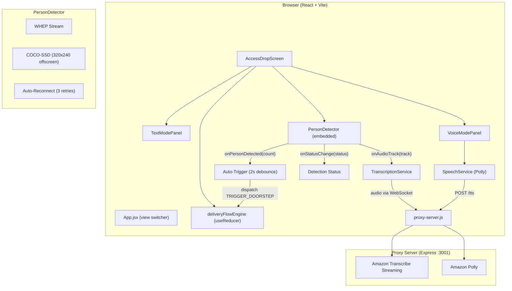

# Design Document: AccessDrop AI

## Overview

AccessDrop AI adds an accessibility-focused delivery interaction screen to the Ring AVA Explorer app. Text Mode displays courier speech as text with action buttons for deaf/hard-of-hearing customers. Voice Mode provides spoken guidance via Amazon Polly for blind/low-vision customers. The system embeds PersonDetector with COCO-SSD for automatic delivery triggering, extracts WHEP audio for Amazon Transcribe, and uses a mock fallback when AWS services are unavailable.

The UI is a side-by-side layout: phone-framed delivery controls on the left, live video stream on the right, with presenter controls (trigger, mock toggle, reset) below the stream.

## Architecture



Key decisions:

1. View switching via React state (no router for MVP)
2. PersonDetector manages its own WHEP lifecycle independently
3. Detection runs on 320x240 offscreen canvas every 3 seconds to avoid blocking the main thread
4. Auto-trigger debounce in AccessDropScreen using useRef/useCallback, keeping deliveryFlowEngine pure
5. Audio track exposed via onAudioTrack callback; transcription only starts when phase is active
6. Transcription guard ref prevents duplicate sessions; restarts on stream reconnect
7. CONFIRM_SAFE_PLACE transitions directly to completed phase
8. Presenter controls (trigger, mock, reset) live outside the phone frame, below the stream
9. System messages use "customer" as sender label

## Components

### PersonDetector.jsx
Props: `{ deviceId, accessToken, onLog, onPersonDetected, onStatusChange, onAudioTrack }`
- WHEP stream with auto-reconnect (3 attempts, 2s/4s/6s delays)
- COCO-SSD on 320x240 offscreen canvas every 3 seconds
- Bounding boxes scaled to visible canvas
- Callbacks on count transitions, status changes, audio track arrival

### AccessDropScreen.jsx
Props: `{ deviceId, accessToken, onBack, onLog }`
- useReducer with deliveryFlowEngine
- Phone frame layout with detection status, mode selector, status bar, panels
- Auto-trigger with 2s debounce using phaseRef to avoid stale closures
- tryStartTranscription with transcribingRef guard (only when phase === 'active')
- Audio track restart on reconnect

### TextModePanel.jsx
- Scrollable messages, stacked full-width action buttons
- Sender labels: courier, customer

### VoiceModePanel.jsx
- Speaking indicator, status, location display
- "Where is my parcel?" shows location or the question itself if unconfirmed

### DeliveryStatusBar.jsx
- Phase indicator with ARIA labels

### deliveryFlowEngine.js
- Pure state machine: idle -> active -> completed
- CONFIRM_SAFE_PLACE transitions to completed
- Messages use "customer" sender

### autoTriggerLogic.js
- Pure helpers for property-based testing

## Data Models

### DeliveryState
```javascript
{ phase, mode, messages, parcelLocation, otpCode, safePlace, startedAt, completedAt, useMockData, error }
```

### Actions
TRIGGER_DOORSTEP, ADD_MESSAGE, CONFIRM_SAFE_PLACE (-> completed), REQUEST_OTP, MARK_RECEIVED, ACKNOWLEDGE_DELIVERY, SET_MODE, SET_MOCK_MODE, SET_ERROR, RESET

## Correctness Properties

1. Doorstep trigger: idle -> active with startedAt
2. Mode switching preserves other state
3. Messages maintain chronological order
4. Confirm safe place: sets location, adds message, transitions to completed
5. OTP request adds OTP message
6. Completion actions: active -> completed with completedAt
7. Action validity depends on phase
8. Detection callback fires on count transitions
9. Debounce guards auto-trigger timing
10. Auto-trigger respects delivery phase

## Error Handling

- WHEP failures: auto-reconnect 3 times, manual trigger as fallback
- Transcription failures: auto-switch to mock mode
- Polly failures: silent no-op
- Invalid state transitions: ignored by reducer
- Audio track timing: transcription starts when track arrives if phase is active
- Duplicate transcription: prevented by transcribingRef guard

## Testing

- 46 tests across 4 files, all passing
- Property-based tests (fast-check, 100+ iterations): autoTriggerLogic
- Unit tests: DeliveryStatusBar, TextModePanel, VoiceModePanel
- Vitest + React Testing Library + fast-check
