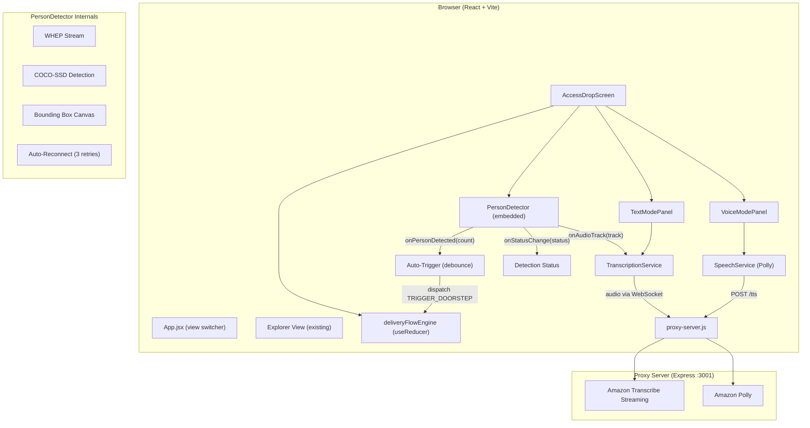

# Design Document: AccessDrop AI

## Overview

AccessDrop AI adds an accessibility-focused delivery interaction screen to the Ring AVA Explorer app. It provides Text Mode (courier speech as text with tap-based actions) for deaf/hard-of-hearing customers and Voice Mode (spoken guidance via Amazon Polly) for blind/low-vision customers. The system embeds a PersonDetector component with COCO-SSD person detection to automatically trigger the delivery flow, extracts audio from the WHEP WebRTC stream for Amazon Transcribe speech-to-text, and uses Amazon Polly for text-to-speech. A mock data fallback ensures reliable demos when AWS services are unavailable.

The UI uses a side-by-side layout: delivery controls in a phone-shaped frame on the left, live video stream on the right.

## Architecture



Key architectural decisions:

1. View switching via React state in App.jsx (no router for MVP)
2. PersonDetector embedded as child of AccessDropScreen, managing its own WHEP lifecycle
3. Auto-trigger debounce logic in AccessDropScreen using useRef/useCallback, keeping deliveryFlowEngine pure
4. Audio track exposed from PersonDetector via onAudioTrack callback for transcription
5. WebRTC auto-reconnect with 3 retries and exponential backoff in PersonDetector
6. AWS calls proxied through Express server to keep credentials server-side
7. Delivery controls wrapped in a phone-frame CSS component for demo presentation
8. Mock data fallback is automatic on AWS failure, with manual toggle

## Components and Interfaces

### PersonDetector.jsx

Props:
```typescript
interface PersonDetectorProps {
  deviceId: string;
  accessToken: string;
  onLog?: (msg: string) => void;
  onPersonDetected?: (count: number) => void;
  onStatusChange?: (status: 'idle' | 'connecting' | 'live' | 'error') => void;
  onAudioTrack?: (track: MediaStreamTrack) => void;
}
```

Features:
- WHEP stream with auto-reconnect (3 attempts, 2s/4s/6s delays)
- COCO-SSD person detection every 1 second
- Bounding box canvas overlay
- Callbacks fire on count transitions, status changes, and audio track arrival
- Independent lifecycle from delivery state

### AccessDropScreen.jsx

Props: `{ deviceId, accessToken, onBack, onLog }`

State:
- `deliveryState` via useReducer with deliveryFlowEngine
- `detectorStatus`, `autoTriggerPending` for detection UI
- `audioTrackRef` for WHEP audio track
- `phaseRef` to avoid stale closures in debounce timer
- `DEBOUNCE_MS = 2000`

Layout: Side-by-side with phone frame (left) and stream (right)

### TextModePanel.jsx
- Scrollable message panel, action buttons (Confirm Safe Place, OTP Help, Mark as Received)
- Props: `{ messages, deliveryState, onAction }`

### VoiceModePanel.jsx
- Speaking indicator, delivery status, parcel location, action buttons
- Props: `{ deliveryState, isSpeaking, parcelLocation, onAction }`

### DeliveryStatusBar.jsx
- Phase indicator (idle/active/completed) with ARIA labels

### Service Layer

- **transcriptionService.js**: WebSocket to proxy, PCM audio extraction from MediaStreamTrack
- **speechService.js**: POST to proxy /api/accessdrop/tts, plays MP3 via AudioContext. Polly only, no Web Speech API fallback.
- **deliveryFlowEngine.js**: Pure state machine (idle -> active -> completed)
- **autoTriggerLogic.js**: Pure helper functions for property-based testing
- **mockData.js**: Predefined courier message sequences

### Proxy Endpoints

- **POST /api/accessdrop/tts**: Polly SynthesizeSpeech, returns MP3
- **WebSocket /ws/transcribe**: PCM audio -> Transcribe Streaming -> JSON results

## Data Models

### DeliveryState
```javascript
{
  phase: 'idle' | 'active' | 'completed',
  mode: 'text' | 'voice',
  messages: [],
  parcelLocation: null,
  otpCode: null,
  safePlace: null,
  startedAt: null,
  completedAt: null,
  useMockData: false,
  error: null,
}
```

### DeliveryAction Types
TRIGGER_DOORSTEP, ADD_MESSAGE, CONFIRM_SAFE_PLACE, REQUEST_OTP, MARK_RECEIVED, ACKNOWLEDGE_DELIVERY, SET_MODE, SET_MOCK_MODE, SET_ERROR, RESET

## Correctness Properties

### Property 1: Doorstep trigger transitions idle to active
*For any* idle state, TRIGGER_DOORSTEP SHALL produce active state with non-null startedAt.

### Property 2: Mode switching preserves other state
*For any* state and target mode, SET_MODE SHALL only change mode, leaving all other fields unchanged.

### Property 3: Messages maintain chronological order
*For any* sequence of ADD_MESSAGE actions, messages SHALL be ordered by timestamp with correct count.

### Property 4: Confirm safe place updates state correctly
*For any* active state and location string, CONFIRM_SAFE_PLACE SHALL set parcelLocation and add a system message.

### Property 5: OTP request adds OTP message
*For any* active state, REQUEST_OTP SHALL add an OTP system message and set otpCode.

### Property 6: Completion actions transition to completed
*For any* active state, MARK_RECEIVED or ACKNOWLEDGE_DELIVERY SHALL produce completed state with non-null completedAt.

### Property 7: Action validity depends on phase
Invalid actions for the current phase SHALL return state unchanged.

### Property 8: Detection callback fires on count transitions
*For any* sequence of detection counts, onPersonDetected SHALL fire exactly once per transition.

### Property 9: Debounce guards auto-trigger timing
TRIGGER_DOORSTEP SHALL dispatch only if person count remains >= 1 for the full debounce period.

### Property 10: Auto-trigger respects delivery phase
Auto-trigger SHALL only dispatch when phase is idle.

## Error Handling

- **WHEP failures**: PersonDetector auto-reconnects (3 attempts). Manual trigger remains as fallback.
- **Transcription failures**: Auto-switch to mock data mode.
- **Polly failures**: Silent no-op with console warning. No Web Speech API fallback.
- **Invalid state transitions**: deliveryFlowEngine ignores invalid actions for current phase.
- **Audio track timing**: If track not available at trigger time, transcription starts when track arrives.

## Testing Strategy

### Property-Based Tests (fast-check, 100+ iterations each)
- Properties 1-7: deliveryFlowEngine state machine (deliveryFlowEngine.test.js)
- Properties 8-10: auto-trigger logic (autoTriggerLogic.test.js)

### Unit Tests
- Component rendering, ARIA labels, keyboard navigation
- Mock data fallback, mode switching, action button states
- Detection status indicator states

### Test Configuration
- Vitest + React Testing Library + fast-check
- Timer mocking via vi.useFakeTimers() for debounce tests
